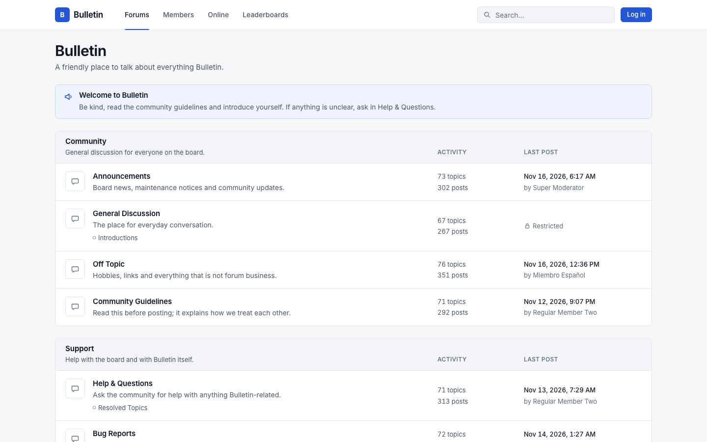
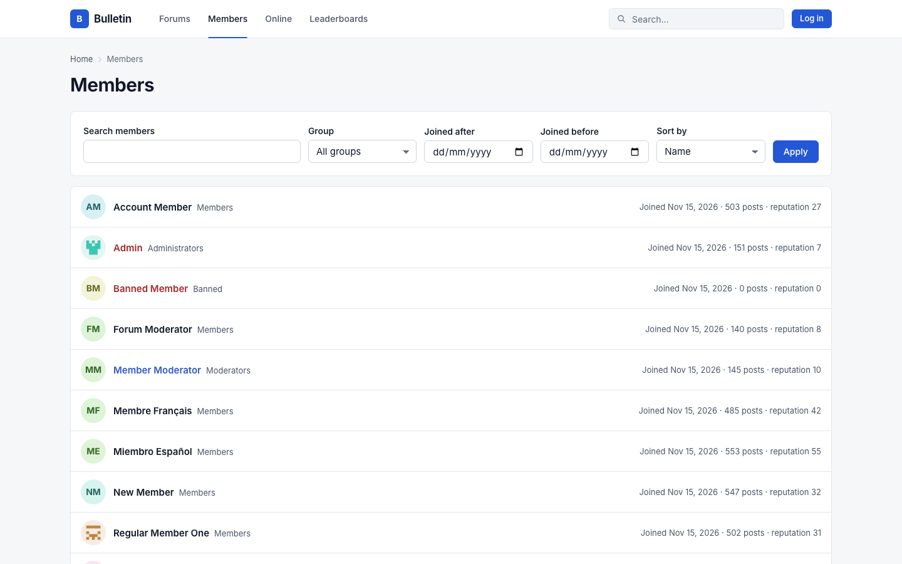
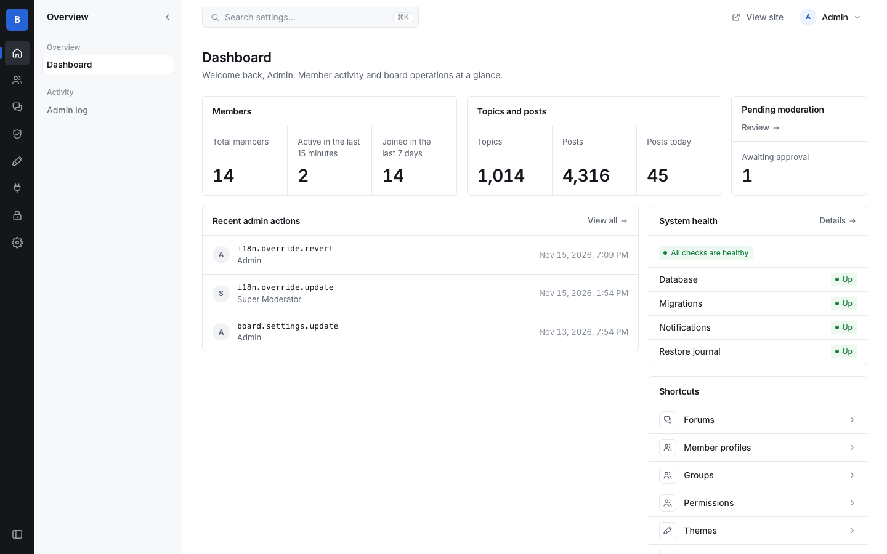

# Bulletin

A community forum built as a Bun monorepo.

## Screenshots

The board index:



The members list:



The staff console dashboard:



## Run it

You need Docker with Compose v2.24 or newer.

```bash
git clone https://github.com/markwylde/bulletin.git
cd bulletin
docker compose up -d
```

The first start builds the images and seeds a demo forum, so give it a few minutes.

## URLs

| URL | What it is |
|---|---|
| http://bulletin.localhost:8080 | Forum |
| http://staff.bulletin.localhost:8080 | Staff admin |
| http://auth.bulletin.localhost:8080 | Sign-in (mock DarkAuth) |
| http://files.bulletin.localhost:8080 | Attachments and avatars |
| http://plugins.bulletin.localhost:8080 | Plugin apps |
| http://bulletin.localhost:8080/_mocks/mail/ | Mock mail inbox |

Stop it with `docker compose down`. Add `-v` to wipe the data.

For development, tests and troubleshooting, see [docs/dev.md](docs/dev.md).

## Contributing

The best contribution you can make is telling me what isn't working. Report
bugs, add screenshots, describe the scenario you were in, and point out ideas
that don't work well in practice, all on the
[GitHub Issues tab](https://github.com/markwylde/bulletin/issues).

Bulletin does not accept pull requests.

## Licence

Bulletin is free software: you can redistribute it and/or modify it under the
terms of the GNU Affero General Public License as published by the Free
Software Foundation, either version 3 of the License, or (at your option) any
later version. See [LICENSE](LICENSE).
